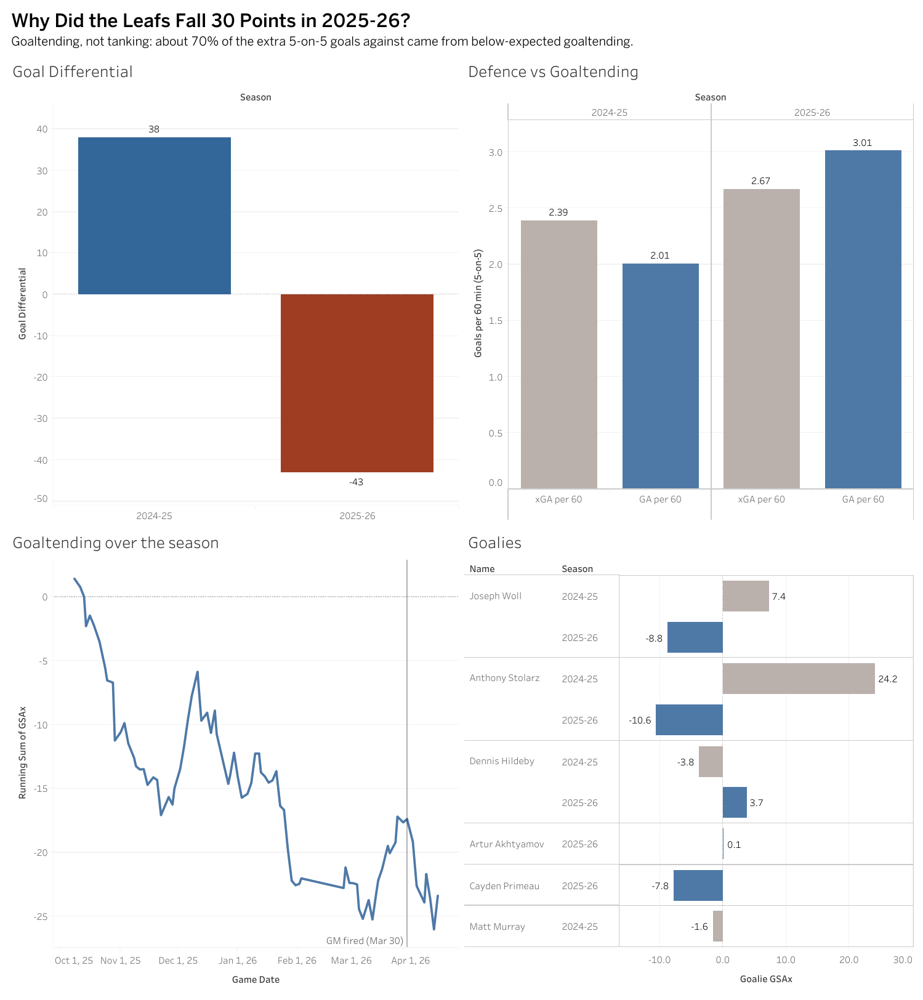

# Toronto-Maple-Leafs-2025-26-Analysis

# Why Did the Toronto Maple Leafs Fall 30 Points in 2025-26?

**A SQL + Tableau analysis of the Leafs' drop from 108 points (2024-25) to 78 points (2025-26).**

📊 **Interactive dashboard:** [View on Tableau Public](https://public.tableau.com/app/profile/sochea.putheesiddh/viz/Leafsseasonanalysis/Dashboard1)

---

## The Question

In 2024-25, the Leafs went 52-26-4 (108 points) and finished 1st in their division. The next season, they went 32-36-14 (78 points), missed the playoffs, fired their GM on March 30, and won the draft lottery.

**Why did they fall so far, and what should the team fix first?**

Many fans blamed losing Marner, Matthews' injury, poor defending, or the team tanking for a top draft pick. This project uses data to test which of these explanations actually holds up.
